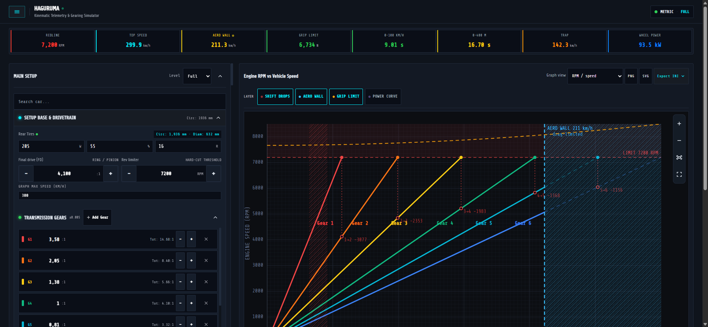
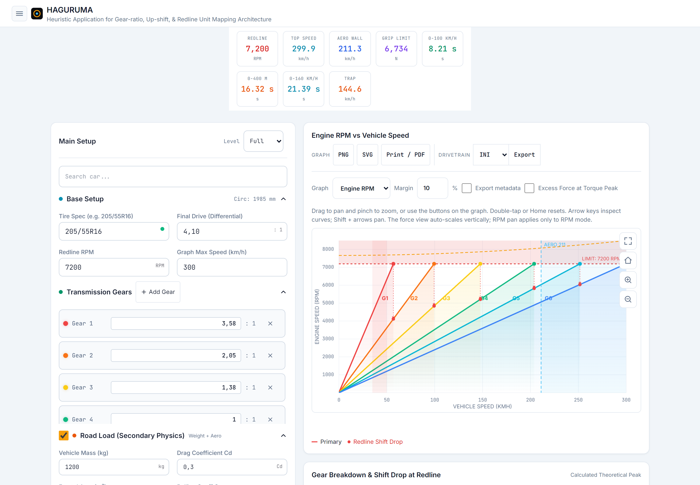
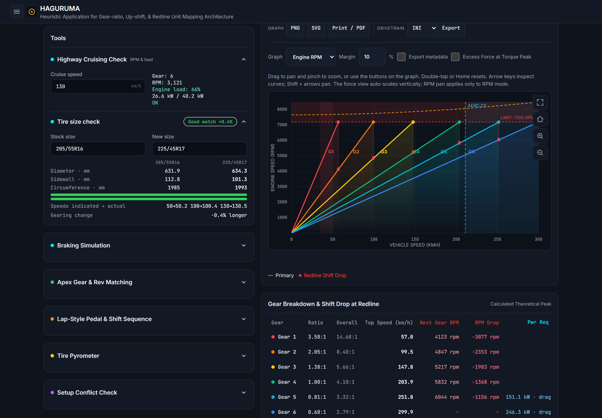
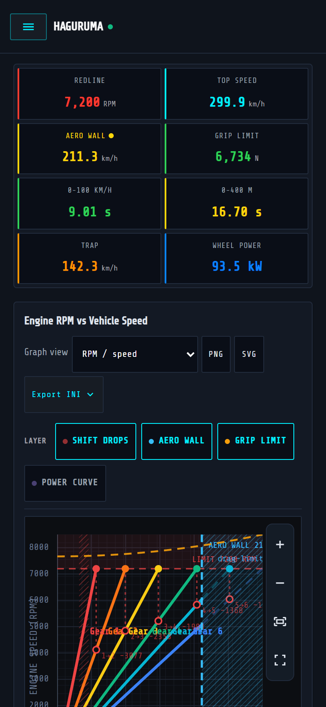

# HAGURUMA

[](LICENSE)
[](https://www.typescriptlang.org/)
[](https://vitejs.dev/)
[](https://vitest.dev/)
[](https://developer.mozilla.org/en-US/docs/Web/Progressive_web_apps)

HAGURUMA is a client-side TypeScript single-page application for exploring
vehicle setups: it plots engine RPM against vehicle speed for every gear,
computes shift drops, estimates road-load physics (mass, aero drag, rolling
resistance, grade), and prescribes shift points through tractive-force
analysis. Everything runs in the browser: there is no application backend, no
account and no server-side configuration. User preferences, saved cars and
session logs are stored locally in the browser, while shareable setup
parameters are encoded in URL hashes.

**Heuristic Application for Gear-ratio, Up-shift, & Redline Unit Mapping
Architecture** — Version **0.9.0** (`package.json`). The physics model, its
assumptions and its validation anchors are documented in
[MATH.md](MATH.md).

[What it does](#what-it-does) · [Requirements](#requirements) ·
[Build and run](#build-and-run) ·
[Controls and everyday use](#controls-and-everyday-use) ·
[Configuration](#configuration) · [Architecture](#architecture) ·
[Limitations and troubleshooting](#limitations-and-troubleshooting) ·
[Development](#development) · [Credits and license](#credits-and-license)

## See it in action

| Desktop, dark theme | Desktop, light theme |
|:---:|:---:|
|  |  |

| Tools column | Mobile |
|:---:|:---:|
|  |  |

## What it does

| Area | What the app does |
|:---|:---|
| Gear & speed math | One RPM-vs-speed ray per forward gear plus a dashed reverse ray, shift-drop connectors with the RPM landing in the next gear, WALL / OVERDRIVE / ECO flags per gear, and a per-gear breakdown table with overall ratios and traction margin. |
| Engine curves | Three-anchor torque model (peak torque RPM/Nm, peak power RPM) with linear interpolation, or a measured dyno curve imported from CSV (comma/semicolon/tab, decimal comma, Nm/kgm, kW/cv/hp, header or header-less) interpolated with Akima and resampled to 64 points. |
| Road load & top speed | Weight, drag, rolling resistance and grade forces per speed; a bisection solver marks the drag-limited top speed with an `AERO` line and flags gears the engine cannot pull. |
| Shift advice | Optimal shift RPM per gear pair from tractive-force crossing with anti-false-positive scanning; `LIMIT` when the rev limiter is the optimal point. |
| Grip & chassis | Load transfer, Kamm friction circle, differential catalog (open, 1/1.5/2-way, Torsen, spool and named models with accel/coast lock), tire treadwear compounds, downforce from lift coefficient and area, and coast/engine-braking lock-up speed. |
| Acceleration KPIs | Fixed-step Euler simulation of 0-100 km/h (or 0-60 mph) and the quarter mile with trap speed, optional rotating inertia, shift torque cut and launch RPM; results memoize on their physical inputs. |
| Graph | Declarative SVG plot with theme-aware palettes, four layer pills (shift drops, aero wall, grip limit, power curve) plus drawer switches for the fine grid and the snap HUD, a wheel-power envelope on its own kW axis, a snapping crosshair plus free tooltip (per-gear RPM, wheel power, grip verdict), pan/zoom in the RPM view, and PNG/SVG export. |
| Graph views | The same host renders the RPM/speed plot, per-gear wheel force, and stopping distance, selected in the graph header. |
| Vehicle dynamics | ABS and per-wheel braking simulation, brake bias and stopping-distance readouts, apex gear advice, a timed throttle/coast/brake sequence (CSV in the state, 60 s cap, over-rev rejected), optional bilinear drivetrain efficiency map, and mirrored differential preload / torque-vectoring / AWD-coupling fields. |
| Comparison | A full secondary vehicle (tire, FD, gears, redline, mass, Cd, area, power, running gear) drawn dashed with delta readouts in the table and the KPI strip. |
| Tools column | Cruise check, tire-size comparator, wheel fitment, telemetry gear recovery and inverse dyno, gear-lab solver with GPX lap import, GPS phone timer with a session log, spec-sheet quick-add wizard, full-state backup, pyrometer calculator, and the setup guide. |
| Setup guidance | Troubleshooting decision tree (entry/mid/exit × understeer/oversteer/transfer/bottoming) with ranked fixes and severity badges, feel-the-car handbook (braking, mid-corner, exit, pyrometer) and the 8-step systematic procedure. |
| Presets | 26 factory/community cars as drop-in JSON under `src/config/cars/`, plus user presets saved to `localStorage` with JSON export/import and a searchable dropdown. |
| Sharing | Full state encoded in the URL hash (packed Base64URL `c` token with verbose-key fallback, `rg_`/`crg_` running-gear blocks, `d_*` dynamics sidecars, `curve` for the dyno), one-click copy and an offline QR modal. |
| Units, language, theme | km/h ↔ mph, kW ↔ cv, five languages (EN, IT, DE, ES, FR), three themes (dark, OLED, light), all persisted. |
| Setup levels | Easy / Medium / Full gating of setup inputs, with the comparison able to sit at a lower level. |
| PWA & offline | `manifest.webmanifest` (standalone, maskable icons) and a service worker (`haguruma-v3`, 3-URL precache, 60-entry runtime cache, 7-day expiry for cached JSON responses). |
| Android | Capacitor wrapper around the same build; a manual GitHub workflow assembles a debug APK artifact. |
| Exports | Graph PNG/SVG, print stylesheet for PDF, drivetrain tables for Assetto Corsa `.ini`, BeamNG `.jbeam`, drivetrain `.json`, tabular CSV for MoTeC / AiM, session-log CSV/JSON, garage and backup JSON bundles. |

Presets, the file formats and the full test inventory each have a single
canonical page: [docs/presets.md](docs/presets.md),
[docs/data-formats.md](docs/data-formats.md) and
[docs/testing.md](docs/testing.md).

## Requirements

| Purpose | Requirement |
|:---|:---|
| Run the dev server, build, test | **Node.js 20 or newer** and npm. All three GitHub workflows pin Node 20; no `engines` field is declared in `package.json`. |
| Use the app | A browser with ES modules, `localStorage` and inline SVG support. No account, no backend; no specific browser is certified by the repository's test suites. |
| Build the Android APK locally | JDK **21**, Android SDK platform `android-35`, build-tools `35.0.0`, and the committed Gradle wrapper under `android/`. The CI workflow installs exactly these. |
| Clone the repository | Git (optional — the repo is not required to use a published build). |

## Build and run

### 1. Prerequisites

**Node.js 20 or newer** with npm (all three GitHub workflows pin Node 20; no
`engines` field is declared in `package.json`), plus Git for cloning. See
[Requirements](#requirements) for the Android toolchain.

### 2. Clone

```bash
git clone https://github.com/camiu01/haguruma.git
cd haguruma
```

### 3. Install dependencies

```bash
npm install
```

### 4. Run locally

```bash
npm run dev   # Vite dev server on http://localhost:5173
```

Before committing, run the typecheck and the test suite (details in
[Development](#development) and [docs/testing.md](docs/testing.md)):

```bash
npx tsc --noEmit   # typecheck, no output on success
npm test           # vitest run
```

### 5. Build and preview

```bash
npm run build    # = npx tsc --noEmit && npx vite build → dist/
npm run preview  # serve dist/ locally
```

`vite.config.ts` sets `base: './'`, so `dist/` works from any static path,
including a subfolder.

Optional extras live outside this quick start: the benchmark
(`npm run bench`) in [Development](#development) and
[docs/testing.md](docs/testing.md), and the local Android APK build
(`npm run androidAPP`) in [Development](#development) and
[docs/deployment.md](docs/deployment.md).

## Controls and everyday use

**Header.** The fixed top bar holds the hamburger drawer button and two
readout chips kept live by `header-bar.ts`: the current speed unit and the
setup level (Easy / Medium / Full).

**Drawer.** Slide-over navigation that scrolls to a section and closes:
primary car, secondary car, engine, setup guide, tools, pyrometer, presets,
plus "My Cars". It also carries the direct switches — language segment
(EN / IT / DE / ES / FR), speed unit (km/h ↔ mph), power unit (kW ↔ cv),
theme segment (dark / OLED / light) — the road-load and comparison toggles,
the display switches (fine grid, snap HUD), garage export/import buttons and
the technical specs.

**Setup sections.** Accordion cards for vehicle, comparison, engine, running
gear and tools. Tire geometry is a pill row (width / aspect / rim); final drive
and rev limiter are ± steppers with live circumference, diameter and 200 km/h
drag readouts. Every refresh goes through a single `renderAll()` entry point,
so control changes are coordinated with the graph through one shared render
pass.

**Graph.** Above the plot: the view selector (RPM / force / braking), the
layer pills, the traction-overlay toggle (force view) and the fullscreen
expand button. Inside the plot: the viewport controls (zoom in, zoom out, fit)
live in the RPM view only, where mouse wheel, drag-pan, `+` / `-` keys and
`Home` / `0` also move the window; force and braking views have no window to
move, so those controls hide. The crosshair snaps to shift points and gear
rays when the snap HUD is on, and the free tooltip reports RPM per gear, wheel
power at the cursor and the grip verdict.

**Tables and KPIs.** The gear table scrolls horizontally with a sticky first
column; the KPI strip stays live (redline, top speed, aero wall, grip, 0-100,
quarter mile, trap, wheel power).

**Tools column.** Each tool is a self-contained accordion card (cruise, tire
size, fitment, telemetry, gear lab, session timer, spec wizard, backup,
pyrometer, setup guide). Nothing here mutates the graph directly — results are
readouts and optional "apply" actions.

**Sharing and export.** The share button encodes the whole setup into the URL
hash and opens a modal with copy and QR (generated offline by the `qrcode`
library). Drawer exports download the graph, the drivetrain tables, the garage
JSON or a full-state backup.

## Configuration

The application needs no server-side or environment configuration: there is no
backend and no `.env`-style settings to supply. Runtime choices — language,
speed/power unit, theme, setup level — are made in the UI and persisted in the
browser (`localStorage` keys below). Development and build settings live in
repository config files (`vite.config.ts`, `tsconfig.json`,
`postcss.config.cjs`, `tailwind.config.cjs`, `capacitor.config.ts`) and apply
only when building from source. Not every piece of state is persisted: the
current setup itself (including an imported dyno curve) lives in memory and is
carried only by the URL hash when shared — see below.

**`localStorage` keys**

| Key | Written by | Contents |
|:---|:---|:---|
| `haguruma-custom-presets` | `core/presets/custom-store.ts` | `{ schemaVersion, presets }` envelope of user cars. |
| `haguruma-lang` | `core/i18n/language.ts` | Active language code. |
| `haguruma-unit` | `core/units/unit-utils.ts` | Speed unit (`kmh` / `mph`). |
| `haguruma-power-unit` | `core/units/unit-utils.ts` | Power unit (`kw` / `cv`). |
| `haguruma-theme` | `core/theme/theme.ts` | `dark` / `oled` / `light`. |
| `haguruma-setup-level` | `services/events/setup-level-events.ts` | Primary Easy / Medium / Full level. |
| `haguruma-comp-level` | `services/events/setup-level-events.ts` | Comparison card level. |
| `haguruma-sessions` | `core/telemetry/session-store.ts` | Versioned session-run log. |

Corrupt or foreign values are validated on read; a bad key degrades to the
default instead of crashing (see [docs/troubleshooting.md](docs/troubleshooting.md)).

**URL hash.** `#…` carries the share payload: a packed Base64URL `c` token for
the full state, verbose keys as fallback and for dyno curves (`curve=rpm:torque;…`),
`rg_`/`crg_` running-gear blocks, and `d_*` sidecars for the v0.7+ dynamics
fields. `restoreFromUrl()` applies whatever validates and ignores the rest.
Exact keys and ranges: [docs/data-formats.md](docs/data-formats.md).

**Setup levels.** Easy shows the everyday inputs, Medium adds the aero and
gearing detail, Full exposes everything (including the differential dynamics
fields). Level changes re-run `applySetupLevel()` and then `renderAll()`.

## Architecture

One mutable state singleton feeds one renderer; the physics lives in pure,
unit-tested modules:

- `src/core/state/app-state.ts` — the single `AppState` singleton (plus
  `engine-curve.ts` for the active curve: anchors vs sanitized dyno points).
- `src/core/math/` — leaf math modules (tire, speed, aero, traction, shift,
  accel, inertia, cruise, dynamics, brake, recovery, dyno parsing, telemetry,
  optimizer, GPX, timer, fitment, pyrometer, powertrain control, active
  differential, drivetrain map) with an explicit dependency order documented in
  [MATH.md](MATH.md).
- `src/views/render-all.ts` — the only refresh entry point.
- `src/services/graph/` — declarative SVG plot: geometry (`svg-frame`), scene
  composition, renderer, viewport/gestures, crosshair, limits, power envelope,
  export.
- `src/services/events/` — one binder per control group.
- `src/components/` — DOM builders (gear list, tables, KPI strip, tools,
  `components/card/` accordion recipe).
- `src/config/` — car catalog (`cars/*.json` + `import.meta.glob` loader),
  presets, differential and compound catalogs, graph constants.
- `src/core/share/`, `src/core/backup/`, `src/core/i18n/` — URL codec, backup
  bundles, five-language dictionaries.
- `index.html` is only the shell; every feature's markup is injected by its
  own `inject*Shell()` builder before refs resolve.

The full directory tree, module tables and render order live in
[docs/architecture.md](docs/architecture.md).

## Limitations and troubleshooting

- **Every number is a model estimate.** No manufacturer data is bundled; the
  efficiency map, ABS constants and compound gains are engineering assumptions
  (see the assumptions section of [MATH.md](MATH.md)). Use the results for
  setup exploration, not for safety-critical or on-track decisions.
- **Saved data is local, with no backend sync.** Saved cars, preferences and
  session logs are stored in this browser's `localStorage` for this origin; the
  application does not provide backend synchronization. Clearing site data
  removes them unless you exported a backup or a garage file first.
- **Storage is per origin and per browser.** Sharing a URL shares the setup,
  not your saved cars.
- **Offline caching can go stale.** The service worker keeps same-origin GET
  assets in a 60-entry stale-while-revalidate runtime cache (only cached
  `.json` responses expire after 7 days); if an update looks missing, reload
  first (navigations are network-first). If that fails, clearing site data
  removes locally stored application data and preferences as well as cached
  assets — export a full backup and any session files first (see
  [docs/troubleshooting.md](docs/troubleshooting.md)).
- **Some platform features are optional.** Clipboard copy falls back to a
  textarea, the wake lock and geolocation are feature-detected, and graph
  gestures are only wired for the RPM view.
- **Heuristic outputs are starting points.** Solver proposals, inverse dyno
  curves and recovered gear ratios come from logged or assumed data.
- **The APK is debug-signed** — suitable for sideloading and testing, not for
  store distribution.

## Development

**Commands** (from `package.json`; there is no lint script — the catalog checks
are ordinary unit tests):

| Command | Action |
|:---|:---|
| `npm run dev` | Vite dev server. |
| `npx tsc --noEmit` | Typecheck (strict mode). |
| `npm test` | `vitest run`. |
| `npm run build` | Typecheck, then `vite build`. |
| `npm run preview` | Serve `dist/` locally. |
| `npm run bench` | `vitest bench --run`. |
| `npm run androidAPP` | Web build, `cap sync android`, `gradlew assembleDebug`. |

**Benchmarks** (`npm run bench`) run every `tests/**/*.bench.ts` file
(currently `tests/accel-math.bench.ts`: anchor curve, 64-point Akima dyno and
active-AWD runs) and report timings without asserting them. The pass/fail
performance guard is separate: `tests/accel-performance.test.ts` runs inside
the ordinary `npm test` suite and fails only if a warm 64-point dyno run
exceeds a 6 ms median locally (8 ms under CI). Full detail in
[docs/testing.md](docs/testing.md).

**Android.** `npm run androidAPP` is `npm run build && npx cap sync android &&
cd android && .\gradlew.bat assembleDebug` (Windows shown; `./gradlew` on
other platforms), producing the debug-signed
`android/app/build/outputs/apk/debug/app-debug.apk` for sideloading. CI does
the same through the **Build APK** workflow; the toolchain and hosting paths
are documented in [docs/deployment.md](docs/deployment.md).

**Verification record.** [docs/testing.md](docs/testing.md) carries the
test inventory and the dated results of the last verified run together with
its commit; re-run `npx tsc --noEmit` and `npm test` to check the current
tree.

**CI.** `.github/workflows/ci.yml` runs on pushes and pull requests to `main`
with Node 20: `npm ci` → `npx tsc --noEmit` → `npm test` → `npm run build`.
`.github/workflows/cd.yml` repeats the build and publishes `dist/` to GitHub
Pages. `.github/workflows/build-apk.yml` is manual (`workflow_dispatch`) or
triggered by a published release: web build, JDK 21, Android SDK
`platforms;android-35` + `build-tools;35.0.0`, `npx cap sync android`,
`./gradlew assembleDebug`, then uploads the renamed APK as the
`haguruma-debug-apk` artifact and attaches it to the release. **The APK
workflow does not run the test suite** — CI does that separately.

**Conventions.** Tabs, single quotes, semicolons, TSDoc on every function,
files under 400 lines and functions under 50 lines (documented in
[AGENTS.md](AGENTS.md)). Comments, docs and commits in English; commits follow
Conventional Commits.

**Documentation map**

| Topic | Page |
|:---|:---|
| Equations, assumptions, validation anchors | [MATH.md](MATH.md) |
| Feature walkthrough | [docs/user-guide.md](docs/user-guide.md) |
| Modules, directories, render order | [docs/architecture.md](docs/architecture.md) |
| File formats, share keys, exports | [docs/data-formats.md](docs/data-formats.md) |
| Tests, benchmarks, CI | [docs/testing.md](docs/testing.md) |
| Presets and the car catalog | [docs/presets.md](docs/presets.md) |
| Builds, Pages, APK | [docs/deployment.md](docs/deployment.md) |
| Errors and recovery | [docs/troubleshooting.md](docs/troubleshooting.md) |
| Release history | [CHANGELOG.md](CHANGELOG.md) · Roadmap [TODO.md](TODO.md) |

## Credits and license

Maintained by **Camiu** ([@camiu01](https://github.com/camiu01)).

Built with [TypeScript](https://www.typescriptlang.org/),
[Vite](https://vitejs.dev/), [Vitest](https://vitest.dev/),
[Tailwind CSS](https://tailwindcss.com/) (compiled through PostCSS),
[Capacitor](https://capacitorjs.com/) and the
[`qrcode`](https://www.npmjs.com/package/qrcode) package. Interface type set in
Share Tech / Share Tech Mono, loaded from Google Fonts; drawer and header icons
from [Icons8](https://icons8.com) (used under its free license — see the
[Icons8 terms](https://icons8.com/license)).

Licensed under **GPL-3.0-only** — see [LICENSE](LICENSE).
